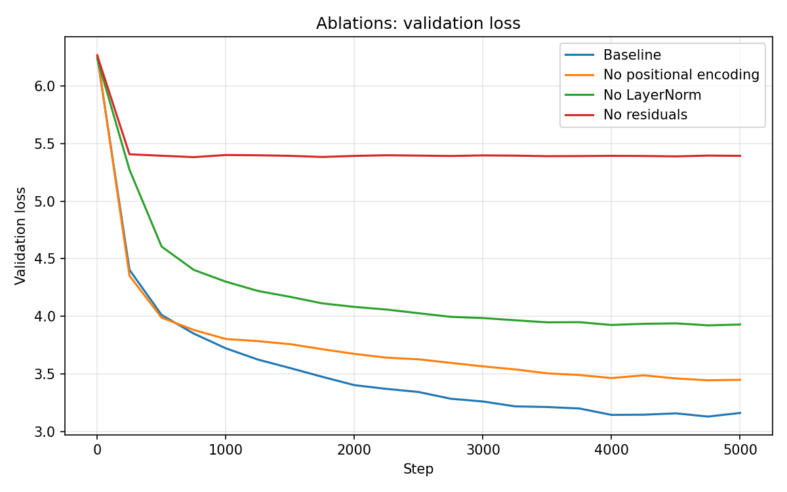
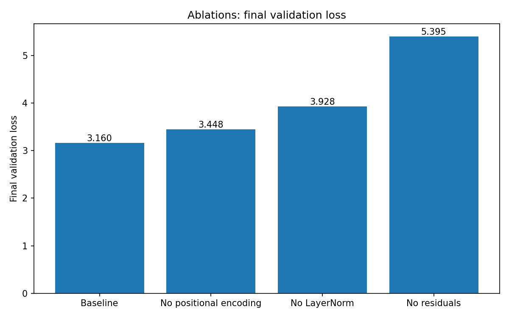

# Transformer From Scratch

A small decoder-only (GPT-style) language model built from scratch in raw PyTorch, trained on TinyShakespeare.

I built this to properly understand how transformers work, not just call a library. Everything important is written by hand: the BPE tokeniser, the attention, LayerNorm, the training loop and the learning-rate schedule. I don't use `nn.Transformer`, `nn.MultiheadAttention`, `nn.LayerNorm` or HuggingFace.

See [plan.md](plan.md) for the build plan.

---

## What's inside

- **BPE tokeniser**: byte-level Byte Pair Encoding written from scratch (train / encode / decode / save / load)
- **Token + positional embeddings**: learned embeddings for both
- **Multi-head causal self-attention**: scaled dot-product attention with a causal mask
- **Feed-forward blocks**: `Linear → GELU → Linear`
- **Layer normalisation**: implemented by hand and checked against PyTorch's version
- **Residual connections**: pre-norm transformer blocks
- **Training loop**: AdamW, gradient clipping, linear warmup + cosine LR decay, checkpointing
- **Ablation studies**: what happens when you remove positional encodings, LayerNorm or residuals
- **Maths notes**: including why attention scales by √d_k ([notes/MATH.md](notes/MATH.md))

## Project structure

```
├── data/input.txt          # TinyShakespeare dataset
├── tokenizer.py            # BPE tokeniser from scratch
├── model.py                # embeddings, attention, FFN, LayerNorm, blocks, GPT
├── train.py                # training loop + LR schedule
├── generate.py             # sample text from a trained model
├── ablations.py            # runs the ablation experiments
├── plot.py                 # loss curve plots (matplotlib)
├── tests/test_shapes.py    # sanity checks
├── results/                # loss logs + plots
├── notes/MATH.md           # the maths behind it
├── notes/scaling_experiment.py  # NumPy experiment for √d_k
└── plan.md                 # build plan
```

## Setup

```bash
python -m venv venv
venv\Scripts\activate        # Windows
# source venv/bin/activate   # Mac/Linux
pip install -r requirements.txt
```

Download the dataset into `data/input.txt`:
```bash
curl -o data/input.txt https://raw.githubusercontent.com/karpathy/char-rnn/master/data/tinyshakespeare/input.txt
```

## Usage

```bash
python tokenizer.py      # train BPE + encode dataset
python train.py          # train the model
python generate.py       # generate text
python ablations.py      # run ablation experiments
python plot.py           # plot the loss curves
python -m pytest tests/  # run tests
```

## Model config

| Parameter | Value |
|---|---|
| Vocab size (BPE) | 512 |
| d_model | 128 |
| Heads | 4 |
| Layers | 4 |
| Context length | 128 |
| Dropout | 0.1 |
| Parameters | 940,800 |

## Results

### Training (5,000 steps, CPU, about 37 minutes)

| Model | Final train loss | Final val loss |
|---|---|---|
| Bigram baseline | 3.673 | 3.889 |
| GPT (this model) | 2.718 | 3.169 |

Losses are cross-entropy per BPE token, in nats. One token covers about 1.96 characters, so 3.169 per token is about 1.62 per character.

### Sample output
`python generate.py --tokens 200` (temperature 0.8, top-k 50):
```
Your eye did heard with a wine some forth
Than her joys of his sons, that comes,
That she dempt your from write their chroose to before
They sweetls against a parted country!
Thy make a pleason, place forgot the Tower's brother
Of it thing of you sign or Boubrake,
Do ward to your majests to acent
Made of serviction of you sly:
```

### Ablation study

Each run uses the same seed, 5,000 steps and the same hyperparameters, with one component removed. These runs were done on a Colab T4 GPU, so the baseline differs slightly from the CPU run above.

| Run | Final train loss | Final val loss | Change vs baseline |
|---|---|---|---|
| Baseline (everything on) | 2.725 | **3.160** | — |
| No positional encoding | 3.050 | 3.448 | +0.29 |
| No LayerNorm | 3.687 | 3.928 | +0.77 |
| No residual connections | 5.362 | 5.395 | +2.24 |

For reference, the bigram baseline reaches 3.889 and a unigram model, which predicts each token's overall frequency and ignores context, reaches 5.389.

- **No positional encoding:** the model trains, but plateaus higher. Without positions, attention cannot use word order, so it learns only from which tokens are present in the context.
- **No LayerNorm:** training is slower from the start and ends worse than the bigram baseline. Activations are not kept on a fixed scale, which makes optimisation harder at the same learning rate.
- **No residual connections:** the loss stops improving after about 250 steps at the unigram level. With no identity path, the gradient must pass through every layer, and the network learns only token frequencies.




## Why divide attention by √d_k?

Short version: if the entries of q and k have variance 1, their dot product has variance d_k. With large d_k the scores get big, softmax becomes almost one-hot, and the gradients almost vanish. Dividing by √d_k brings the variance back to 1 and keeps training stable. The full derivation and a small NumPy experiment are in [notes/MATH.md](notes/MATH.md).

## What I learned

_(to be filled in)_

## What I'd do next

- Rotary positional embeddings (RoPE)
- KV-cache for faster generation
- Train on a bigger dataset
- Weight tying between the embedding and output layers

## References

- Vaswani et al., [*Attention Is All You Need*](https://arxiv.org/abs/1706.03762) (2017)
- Andrej Karpathy, *Let's build GPT: from scratch, in code, spelled out*
- Andrej Karpathy, *Let's build the GPT Tokenizer*
